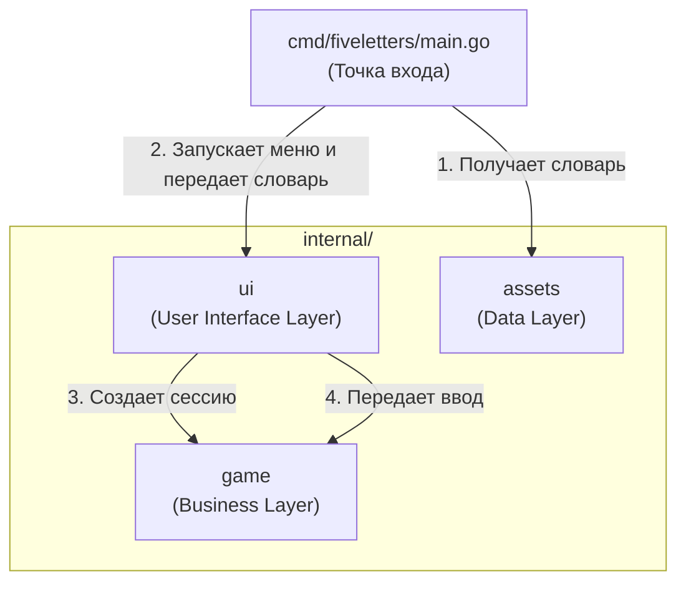

# fiveletters

[](https://golang.org/)

## Описание
«5 букв» - консольная игра в духе Wordle. Программа загадывает слово из пяти русских букв, а игрок должен угадать его за шесть попыток.

## Требования к запуску
- Go 1.26.0 или новее в пределах ветки 1.26
- GNU Make - необязательно, все команды можно выполнить напрямую

### Сборка и запуск

| Команда                | Назначение                                                                               |
| ----------------------------- | -------------------------------------------------------------------------------------------------- |
| `make install`              | Скачать зависимости приложения и локальный линтер      |
| `make build`                | Собрать исполняемый файл в каталоге `bin`                          |
| `make run`                  | Запустить приложение                                                            |
| `make run ARGS="--seed 42"` | Запустить приложение с аргументами                                  |

### Флаги

- ```--seed int64``` - запустить с конкретным сидом рандома, по умолчанию от времени
- ```--replay word1,word2,word3``` - запустить рейплей, где wordN - попытка N

Пример:

```ARGS="--seed 28 --replay кошка,клоун"```

### Тестирование

| Команда                | Назначение                                                                               |
| ----------------------------- | -------------------------------------------------------------------------------------------------- |
| `make format`               | Отформатировать код через gofumpt и goimports                              |
| `make test`                 | Запустить `go test` и создать HTML-отчет покрытия                   |
| `make test-race`            | Дополнительно проверить тесты с race detector (требуется CGO) |
| `make check`                | Проверить `go.mod`, форматирование и golangci-lint                        |

## Архитектура

Для данного проекта мною была выбрана слоистая архитектура (Layered Architecture).

Ее преимущества: 
- четкое разделение обязанностей
- изоляция слоев
- гибкость и расширяемость
- удобство unit-тестирования

Недостатки:
- избыточность кода в небольшом проекте
- необходимость проектирования архитектуры
- риск чрезмерного использования абстракций (антипаттерн)

```
├── cmd
│   └── fiveletters - Composition Root (точка входа программы)
└── internal
    ├── assets - Data Layer (загрузка словаря)
    ├── game - Business Layer (правила игры)
    └── ui - User Interface Layer (CLI)
```

Архитектура опирается на принципы SOLID:
- S - Single Responsibility Principle (SRP) - в коде ответственности разделены путем использования изолированных пакетов: CLI ничего не знает о правилах игры
- I и D не используются исходя из YAGNI - зависимости передаются через конкретные структуры, а не абстрактные интерфейсы


